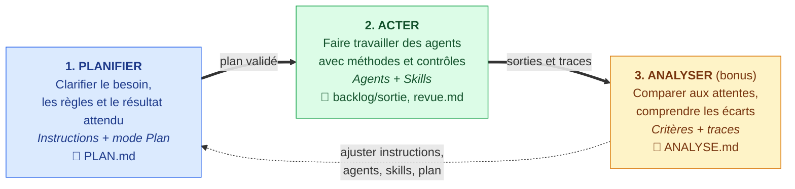

# 🚀 Atelier — Du besoin métier au backlog avec GitHub Copilot

> 🏢 Fil rouge : **SprintDesk chez HabiOuest** (cas fictif, voir [`sprintdesk/contexte/produit.md`](sprintdesk/contexte/produit.md))
> 👥 20 participants (PO/PM, Scrum, Dev, DevOps) · 4 groupes mélangés de 5 · un lot par groupe

## 🔄 Le cycle Planifier → Acter → Analyser


## 📂 Contenu du dépôt
```
📁 sprintdesk/
 ├─ 📁 contexte/          produit.md, regles-metier.md (règles validées + décisions non prises)
 ├─ 📁 backlog/
 │   ├─ 📁 entree/        20 US par lot (lot1..lot4)
 │   └─ 📁 sortie/        production des groupes
 └─ 📁 resultats/         revue, synthèse, ANALYSE
📁 .github/               squelettes : instructions, 2 agents, 2 skills
📁 docs/                  guides pas à pas par atelier + aide-mémoire PDF
📁 animateur/             fiches-groupes.md, corrige.md (🔒 à ne pas distribuer)
📄 PLAN.md                produit par chaque groupe à la racine
```

## 🏢 Contexte
HabiOuest, bailleur social régional (12 agences, 450 collaborateurs), reçoit les demandes métier de ses équipes par e-mail et tableur partagé : demandes perdues, priorités contestées, aucun suivi. La DSI lance **SprintDesk** pour centraliser, qualifier, prioriser et suivre ces demandes.

## ❓ Problématique
Le backlog initial est inexploitable en l'état : US vagues, trop volumineuses, contradictoires ou sans critères d'acceptation. Certaines règles sont validées (`RM-xx`), d'autres décisions **n'ont pas été prises** (`ND-xx`) et ne doivent pas être inventées.

## 🤖 Le défi avec Copilot
Un agent générique « améliore » volontiers une US… en inventant des règles, en réécrivant ce qui était correct et sans dire ce qu'il a vérifié. Le défi : transformer Copilot en **assistant métier encadré** (un *harness*) :
- 📏 **Instructions** pour le contexte du projet et les règles communes (ne pas inventer, tracer, distinguer faits / propositions / questions) ;
- 🧑‍💼 **Agents** aux rôles séparés (un Reviewer qui diagnostique, un Rédacteur qui réécrit) ;
- 🧰 **Skills** pour les savoir-faire réutilisables (format d'US, revue agile) ;
- ✅ **Validation humaine** sur les décisions métier et avant toute publication.

🎯 Résultat attendu : un backlog exploitable, traçable, et des questions ouvertes visibles plutôt que des réponses inventées.

### 💡 Rappel : le cycle Planifier → Acter → Analyser, c'est quoi ?
La méthode pour travailler avec Copilot sans lui laisser improviser :
- 🧭 **Planifier** : avant toute action, on clarifie avec Copilot (mode Plan) le besoin, les règles, les questions ouvertes et le résultat attendu. On obtient un plan validé (`PLAN.md`) qui dit ce que les agents feront, ne décideront pas et comment on les jugera.
- ⚙️ **Acter** : on transforme ce plan en dispositif réutilisable (instructions, agents, skills) puis on le fait travailler, avec validation humaine entre les étapes.
- 🔍 **Analyser** : on compare le résultat aux attentes, on identifie l'origine d'un défaut (source, plan, instructions, agent, skill) et on ajuste **un seul élément** avant de rejouer.

L'humain décide, Copilot exécute dans un cadre explicite, et chaque tour de cycle améliore le cadre.

## 🗺️ Le parcours
| Temps | Ce que les groupes pratiquent |
|---|---|
| 🧭 **Atelier 1 — Planifier** | Rédiger des **instructions claires** du contexte du projet, puis **prompter** pour obtenir un plan clair et bien construit (`PLAN.md`) |
| ⚙️ **Atelier 2 — Acter** | Définir l'**architecture des agents** et leur rôle dans le cycle de développement (SDLC), puis créer les **agents** et les **skills** qui exécutent le plan |
| 🔍 **Bonus — Analyser** | **Évaluer et ajuster** : critères de succès, signaux qualitatifs et quantitatifs, analyse des traces et des sorties, distinction entre erreur de raisonnement, mauvais outil, mauvais contexte et environnement, puis ajustement des instructions, outils, contraintes et mémoire |

## 📦 Lots
| Groupe | Lot | US |
|---|---|---|
| 1️⃣ | Dépôt des demandes | 101–105 |
| 2️⃣ | Qualification et priorisation | 201–205 |
| 3️⃣ | Traitement des demandes | 301–305 |
| 4️⃣ | Pilotage du backlog | 401–405 |

Chaque lot : une US vague, une trop volumineuse, une contradictoire, une sans critères, une déjà correcte.

## 📚 Guides pratiques
Voir [`docs/README.md`](docs/README.md) : instructions, plan, architecture des agents, agents, skills, prompts et évaluation.

## 🛠️ Avant la formation
1. 📤 Distribuer une copie du dépôt par groupe, avec son seul lot dans `entree/`, sans `animateur/`.
2. 🎤 Préparer les présentations 1 et 2 (contexte/instructions/outils ; agents vs skills).

## 🏁 Socle de réussite
- ✔️ Un `PLAN.md`, deux agents, deux skills, cinq US traitées avec traçabilité.
- 🎁 Bonus : `ANALYSE.md` (critères de succès, constats, une modification testée).
- 🚧 Extensions : agent expert agilité, skill `preparer-publication`, superviseur et sous-agents, publication GitHub Issues (avec prévisualisation et validation humaine), boucle d'analyse.
